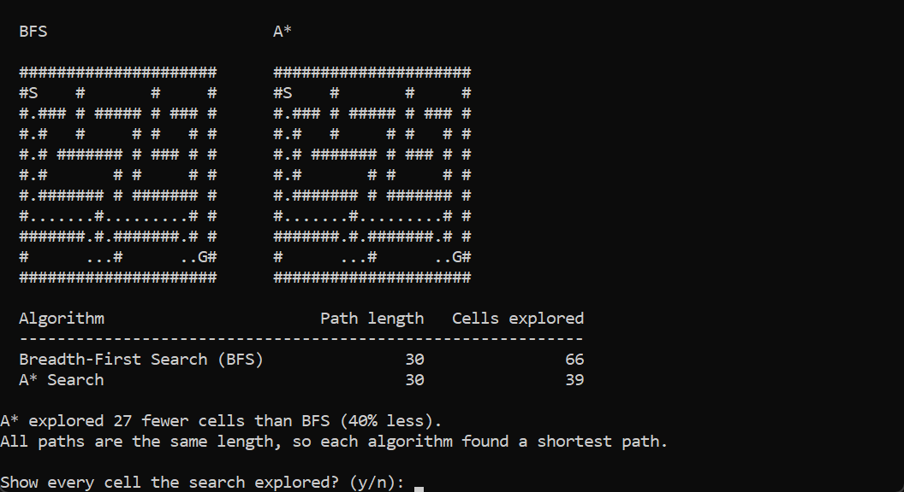

# Matthew Moreno · Developer Portfolio

**Live site: [mattsound.github.io](https://mattsound.github.io)**

I'm a Computer Science student at Full Sail University focused on software engineering and artificial intelligence. This repository holds my personal portfolio website, published with GitHub Pages.



## Featured Project: Maze Pathfinder

A C++ console application that shows how the BFS and A* pathfinding algorithms search a maze, then turns that search into a chase game against an AI enemy.

- **Repository:** [Mattsound/COS1-Project](https://github.com/Mattsound/COS1-Project)
- **Demo video:** [youtu.be/LKnvy6lmrus](https://youtu.be/LKnvy6lmrus)
- **Highlights:** 14 classes, a polymorphic `Pathfinder` base class, save and load file I/O, and a 98-check automated self-test

## What's on the Site

| Section | Contents |
|---|---|
| Home | Who I am and what I'm working toward |
| About | My background, interests, and goals |
| Skills | The languages, tools, and concepts I used this month |
| Projects | Maze Pathfinder: overview, features, screenshots, development challenge, and what I learned |
| Contact | Email, GitHub, and my résumé |

## Built With

- HTML and CSS (no frameworks)
- Responsive layout that works on desktop and mobile
- GitHub Pages, deployed from the `main` branch

## Repository Structure

```text
index.html     the whole site, one page
css/           style.css
images/        project screenshots and the maze logo
assets/        résumé (PDF)
```

## Running It Locally

No build step is needed. Clone the repository and open `index.html` in a browser.

```bash
git clone https://github.com/Mattsound/Mattsound.github.io.git
```

## Workflow

Changes are made on the `dev` branch, reviewed in a pull request, and merged into `main`, which GitHub Pages publishes automatically.

## Contact

- Email: [mm.mattmoreno@gmail.com](mailto:mm.mattmoreno@gmail.com)
- GitHub: [@Mattsound](https://github.com/Mattsound)
- Résumé: [matthew-moreno-resume.pdf](assets/matthew-moreno-resume.pdf)
